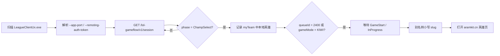

# ARAMKit Invoker

[](https://github.com/eliozh/aramkit-invoker/actions/workflows/build-windows.yml)

Windows 桌面小工具：通过英雄联盟国服客户端的本地 LCU API，在**海克斯大乱斗（ARAM: Mayhem，队列 2400）**确认进入游戏后，自动用默认浏览器打开 ARAMKit 中对应英雄的页面：

```text
https://aramkit.cn/zh-CN/champions/<champion>
```

## 功能

- 自动发现正在运行的 `LeagueClientUx.exe`，读取它的 LCU 端口与临时令牌。
- 轮询游戏流程状态；在海克斯大乱斗英雄选择期间记录本地玩家英雄。
- 在英雄选择结束、客户端进入 `GameStart`（约 2 秒宽限）或 `InProgress` 时打开 ARAMKit 页面；秒退或加载失败不会误触发。
- 关闭主窗口时最小化到系统托盘；托盘图标悬停显示：
  - `等待客户端连接`
  - `客户端已连接`
- 主窗口实时显示连接状态、当前阶段、队列、英雄和最近打开的页面。
- 可配置 ARAMKit 桌面程序路径；此后每次启动本程序都会自动启动它。

## 构建

建议直接在 Windows 上构建（需要 Rust MSVC 工具链和 Visual Studio Build Tools）。

```powershell
rustup default stable
cargo build --release
```

产物：

```text
target\release\aramkit-invoker.exe
```

依赖使用 Windows 自带的 SChannel（`native-tls`），不需要额外安装 OpenSSL。

也可以用 GitHub Actions 构建：推送到 `main`、手动运行 **build-windows** workflow，或推送 `v*` 标签。普通构建的 exe 在 Actions 的 artifact `aramkit-invoker-windows-x64` 中；`v*` 标签会自动创建 GitHub Release 并附加 exe。

Linux 下仅用于代码检查/单元测试，托盘和文件选择器是 Windows 专用：

```bash
cargo test
cargo clippy --all-targets -- -D warnings
cargo check --target x86_64-pc-windows-msvc
```

## 使用

1. 启动 `aramkit-invoker.exe`。
2. 在“ARAMKit 桌面端”一栏选择 ARAMKit 的 `.exe` 或 `.lnk` 路径，点击“保存”。
3. 正常启动英雄联盟客户端，进入海克斯大乱斗。
4. 英雄选择结束、进入加载界面时，浏览器会自动打开对应英雄的 ARAMKit 页面。
5. 关闭窗口不会退出程序；右键托盘图标可“显示主窗口”或“退出”。

配置文件位置：

```text
%APPDATA%\aramkit-invoker\config.json
```

## 工作方式



使用的只读 LCU 接口：

- `GET /lol-gameflow/v1/session` — 游戏阶段、队列、游戏 ID。
- `GET /lol-champ-select/v1/session` — 本地玩家格位与当前英雄。
- `GET /lol-game-data/assets/v1/champion-summary.json` — 英雄 ID → 名称/别名。

触发只在“英雄选择结束并进入游戏”时发生，因此英雄选择期间有人秒退不会打开页面。英雄在海克斯大乱斗中换人（骰子/交换）时，会记录最后一次看到的英雄。

## 安全说明

- 只访问 `https://127.0.0.1:<LCU端口>`，关闭系统代理并禁用 HTTP 重定向，避免请求离开回环地址。
- LCU 使用自签名证书，客户端仅对回环地址关闭证书校验。
- 令牌只存在内存中，不写配置、不打印日志（`Debug` 输出已脱敏），释放时清零。
- 本地接口响应限制为 2 MB，防止异常响应耗尽内存。
- 浏览器只允许打开 `https://aramkit.cn/zh-CN/champions/` 下、由字母数字 slug 组成的页面。
- ARAMKit 桌面端路径仅允许**绝对本地路径**且后缀为 `.exe` / `.lnk`；拒绝 UNC/相对路径，使用 `ShellExecuteW` 启动，不经过 `cmd.exe`。
- 不注入游戏进程、不修改客户端，只读取本地 API。
- 本工具信任本机运行的 League 客户端；请在可信的电脑环境中使用。

## 已知限制

- 仅支持 Windows；程序需要在英雄选择结束前保持运行。
- 如果 Riot 更改了海克斯大乱斗的队列号，请修改 `src/champion.rs` 中的 `MAYHEM_QUEUE_ID`（当前为 `2400`）。
- 页面在加载界面阶段打开；如果希望更早打开，可调整 `src/tracker.rs` 的触发阶段。
- 系统托盘使用 `tray-icon`；若 Explorer 未就绪，托盘创建可能失败，此时程序会在日志中提示，关闭窗口将直接退出。

## 目录结构

```text
src/
├── main.rs          应用入口与窗口参数
├── app.rs           egui 界面、托盘联动、配置交互
├── theme.rs         颜色、样式与展示辅助
├── tray.rs          Windows 系统托盘（其他平台为开发用占位实现）
├── icon.rs          运行时生成的应用/托盘图标
├── lib.rs
├── champion.rs      英雄 slug、ARAMKit URL、队列判断
├── config.rs        JSON 配置读写
├── platform.rs      打开浏览器、启动桌面程序、文件选择
├── tracker.rs       海克斯大乱斗英雄确认状态机
└── lcu/
    ├── mod.rs       事件与状态类型
    ├── creds.rs     进程/命令行/lockfile 凭据发现
    ├── model.rs     LCU JSON 模型
    ├── client.rs    HTTPS 请求
    └── watcher.rs   后台轮询与触发
```
